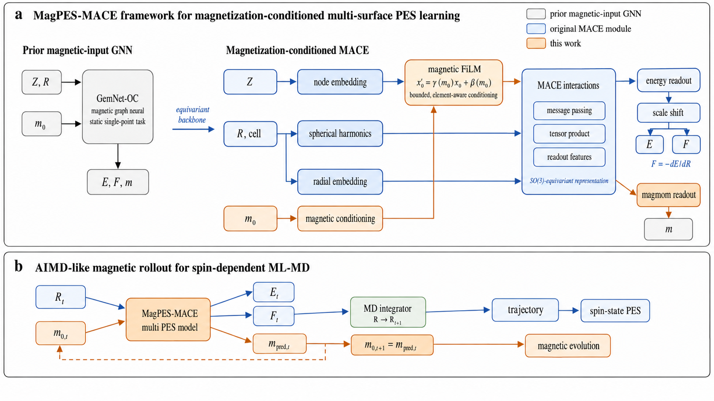

# MACE-FiLM

MACE-FiLM conditions a MACE potential on atom-resolved initial magnetic
moments and predicts energies, forces, and local magnetic moments. This
repository is a compact, code-oriented release: it contains the model and
training implementations, portable ASE MD/PES examples, the checkpoints
needed by those examples, and the workflow figure. Full paper figures and
their processed plotting tables are intentionally not mirrored here.



## Repository layout

```text
mace_film/                    model, training, ASE MD, and PES source
examples/fen4/                FeN4-O2 MD and PES examples
examples/mn_au_o2/            Mn-Au-O2 MD and PES examples
examples/ceo2/                CeO2 magnetic-localization MD example
figures/workflow.png          paper workflow figure (Figure 1)
```

Each example contains only:

- checkpoint files needed for the demonstrated task;
- small structural inputs and atomic-energy references;
- a small `.extxyz.gz` sample documenting the training-data schema;
- Slurm scripts for the retained MD/PES workflows;
- a short system-specific README.

The samples are not substitutes for the complete production datasets and
must not be used to reproduce paper statistics.

Decompress a schema sample before passing it to the training entry point:

```bash
gzip -dk examples/fen4/inputs/train_sample.extxyz.gz
```

## Installation

Install an upstream MACE version compatible with the source in this release,
then install the remaining dependencies:

```bash
python -m pip install -r requirements.txt
export PYTHONPATH="/path/to/upstream/mace:$PWD:$PYTHONPATH"
```

The examples default to `/home/wuzhihong/software/mace` for the upstream MACE
source. Override this portable path at submission time when needed:

```bash
MACE_SOURCE=/path/to/mace sbatch examples/fen4/scripts/run_md.slurm
```

## Retained workflows

### FeN4-O2

- MD checkpoint: `examples/fen4/models/md_spp_previous_best.pt`
- PES checkpoint: `examples/fen4/models/pes_afm_energy10_best.pt`
- MD: `sbatch examples/fen4/scripts/run_md.slurm`
- PES: `sbatch examples/fen4/scripts/run_pes.slurm`

The PES checkpoint is the Old E10 model selected for the manuscript. The
same checkpoint is used for both AFM and FM PES branches; no branch-specific
FM model is used. The MD and PES checkpoints differ because those workflows
emphasize different regions of configuration space.

### Mn-Au-O2

- common MD/PES checkpoint:
  `examples/mn_au_o2/models/pes_md_spp_previous_best.pt`
- MD: `sbatch examples/mn_au_o2/scripts/run_md.slurm`
- PES: `sbatch examples/mn_au_o2/scripts/run_pes.slurm`

The same previous-conditioned checkpoint is retained for the two example
workflows.

### CeO2

- MD checkpoint: `examples/ceo2/models/mixed_2O3O4O_softmax_best.pt`
- MD: `sbatch examples/ceo2/scripts/run_md.slurm`

The checkpoint was trained on a mixed 2O/3O/4O dataset. The paper uses this
system for magnetic-site localization and ML-MD, not for a static constrained
PES scan; consequently no artificial CeO2 PES example is included.

## Source entry points

```text
mace_film/mace_magmom_film.py
mace_film/train_fen4_mace_magmom_film.py
mace_film/run_md_mace_film.py
mace_film/scan_fe_o2_adsorption_mace_film.py

mace_film/systems/mn_au_o2/mace_magmom_film.py
mace_film/systems/mn_au_o2/train_mn_au_mace_magmom_film.py
mace_film/systems/mn_au_o2/run_md_mace_film.py
mace_film/systems/mn_au_o2/scan_mn_au_o2_adsorption_mace_film.py

mace_film/systems/ceo2/mace_magmom_film.py
mace_film/systems/ceo2/train_ceo2_mace_magmom_film.py
mace_film/systems/ceo2/run_md_mace_film.py
```

All inference entry points accept `--atomic-energy-linref`. This overrides
the historical absolute path stored inside a checkpoint and makes the
released examples portable.

## Magnetic conditioning

The default model conditions the initial scalar node embedding with an
atom-wise FiLM transformation derived from normalized initial magnetic
moments. MD can optionally feed predicted moments into the next step with
`--rollout-magmom`; PES examples keep the supplied branch template fixed
unless explicitly configured otherwise.

### Optional single-forward magnetic-reversal symmetry

Default (--spin-feature-mode legacy): original signed-moment MACE-FiLM.
All pretrained examples in this repository use the original architecture.
The optional symmetry mode was not enabled for the main-manuscript PES
or MD calculations.

Opt-in (--spin-feature-mode even_pair): the model constructs the magnetic
descriptor q_i = (s_i^2, s_i * sbar_i), where s_i is the normalized
local moment and sbar_i is a distance-weighted average of neighboring
magnetically conditioned moments. The two FiLM inputs are even under
global spin reversal; the neighbor correlation term can distinguish
different relative magnetic alignments (FM vs AFM).
A two-coefficient odd-moment readout uses the bases (s_i, sbar_i).
For even_pair:

- E(R, m) = E(R, -m).
- F(R, m) = F(R, -m), at fixed magnetic conditioning inputs.
- m_pred(R, -m) = -m_pred(R, m).

The symmetry-preserving mode uses ONE forward pass, not feature averaging
over positive/negative magnetic initializations. It is opt-in.

Example new training options:

    --spin-feature-mode even_pair
    --conditioning-mode film
    --magmom-condition-elements Fe O
    --magmom-supervise-elements Fe O
    --total-magmom-w 0

At present, the even_pair option is integrated into the primary FeN4
model/training entry points. The system-specific Mn-Au-O2 and CeO2 model
copies still use their original implementations.

The new mode requires newly trained weights: the FiLM input dimension
and the magnetic-moment readout head differ from legacy checkpoints.
Do not force-load legacy weights as an even_pair model.

The historical --enforce-spin-inversion flag is separate and cannot
be combined with even_pair. See docs/INTEGRATION_NOTES_20261030.md
for migration details and verification status.

## Scope of this release

Removed from this GitHub repository:

- paper PES/MD/statistical figures other than Figure 1;
- figure-data CSV files;
- full production training datasets;
- raw VASP outputs and full AIMD/ML-MD trajectories;
- exploratory checkpoints, training histories, and duplicated metadata.

Complete paper data should be deposited separately in a persistent research
data archive. See `DATA_AVAILABILITY.md` and `MANIFEST.csv` for the retained
release contents and checksums.
